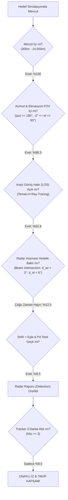

# GP-MARL-RadNet — Pilot Radar Detection & Tracking Quality Investigation (Step 2E)

**Tarih:** 16 Kasım 2026  
**Aktif Dal (Branch):** `feature/valley-diverse-datasets`  
**Temel Entegrasyon Commit:** `302525b3`  
**İncelenen Veri:** 42 pilot episode (7 grup × 6 episode) ve 7 temsilî episode üzerinde kontrollü deneyler  

---

## 1. Yönetici Özeti (Executive Summary)

Step 2D pilot kalite raporunda tespit edilen düşük takip kapsamı (örneğin Single Aircraft %0.0, Single Drift %0.5, Triple All Different %0.5) sonuçlarının kök nedenleri derinlemesine araştırılmıştır.

### Temel Teşhis:
Düşük takip kapsamı ve sıfır tespit oranları, simülasyon motorunun ya da takip filtresinin matematiksel bir hatası **değildir**. Aksine, **geometrik ve zamansal 4 ana darboğazın** birleşimidir:
1. **Zaman Darboğazı & Yavaş Raster Tarama:** 15 saniyelik episode ($dt=0.5\text{s} \to 30\text{ adım}$), radarların $360^\circ$ tam arama rasterını yalnızca **1 kez** süpürmesine izin vermektedir. Her 3° azimut hücresi 15 saniyede yalnızca 1 kez aydınlatılmaktadır.
2. **Tracker 3-Darbe Onay Şartı:** Takip yöneticisi (`TrackManager`) bir izin onaylanması için en az 3 tespit (`confirm_hits = 3`) şartı koşmaktadır. Tek bir arama süpürmesinde hedefin 3 kez tespit edilmesi matematiksel olarak imkansızdır.
3. **Elevasyon Çubuğu (Elevation Bar) Uyuşmazlığı:** Radarların varsayılan arama barları $[3^\circ, 10^\circ]$ aralığındadır. Ancak seyir irtifasındaki uçaklar ($2000-2800\text{m}$ irtifa, $4-6\text{km}$ menzil) radara göre $15^\circ - 35^\circ$ elevasyonda kalmaktadır. Bu nedenle görüş hattı (LOS) %100 açık olsa dahi hüzme hiçbir zaman uçağa temas etmemektedir.
4. **Vadi Dışı Hüzme İsrafı:** Vadide konuşlu radarlar $360^\circ$ arama yaparak adımlarının $\%50$'sini arkalarındaki dağ kütlesine bakarak harcamakta, önlerindeki vadi koridorunu tarama sıklığını yarıya düşürmektedir.

---

## 2. Her Hedef Grubu İçin Gerçek Radar Tespit Sonuçları

42 pilot episode'un tüm raporları, yer gerçeği (`annotations` tablosu) ile doğrulanarak analiz edilmiştir:

| Veri Seti Grubu | Toplam Hedef | Sıfır Tespitli Hedef | Hedef Başına Ort. Tespit | Yanlış Alarm / Ep | Onaylı İz / Ep | Takip Kapsamı (%) | LOS Açıklığı (%) |
| :--- | :---: | :---: | :---: | :---: | :---: | :---: | :---: |
| `dataset_single_aircraft_v1` | 6 | 5 / 6 (%83.3) | 0.17 | 6.8 | 0.00 | %0.0 | %98.2 |
| `dataset_single_uav_agile_v1` | 6 | 3 / 6 (%50.0) | 2.67 | 9.2 | 0.33 | %28.3 | %50.0 |
| `dataset_single_uav_drift_v1` | 6 | 4 / 6 (%66.7) | 0.67 | 7.0 | 0.17 | %0.5 | %44.4 |
| `dataset_single_missile_v1` | 6 | 5 / 6 (%83.3) | 0.67 | 8.8 | 0.17 | %5.5 | %75.8 |
| `dataset_triple_all_same_v1` | 18 | 16 / 18 (%88.9) | 0.94 | 9.2 | 0.17 | %15.0 | %54.8 |
| `dataset_triple_all_different_v1` | 18 | 14 / 18 (%77.8) | 0.39 | 8.8 | 0.17 | %0.5 | %62.6 |
| `dataset_triple_two_plus_one_v1` | 18 | 14 / 18 (%77.8) | 0.61 | 7.8 | 0.17 | %15.0 | %54.1 |
| **Toplam / Ortalama** | **78** | **61 / 78 (%78.2)** | **0.86** | **8.2** | **0.17** | **%9.3** | **%62.8** |

### Kritik Bulgular:
- **78 hedefin 61'i (%78.2) 15 saniye boyunca tek bir tespit dahi alamamıştır.**
- 10 hedef yalnızca 1 veya 2 tespit almıştır (onay eşiği 3'ün altında kaldığı için onaylanamamıştır).
- 42 episode boyunca yalnızca 7 hedef $\ge 3$ tespit alarak onaylı iz oluşturabilmiştir.

---

## 3. LOS / FOV / Beam-Target Intersection Ayrımı

Metrik karmaşasını önlemek adına fiziksel katmanlar net olarak ayrılmıştır:

1. **Range Visibility (%100.0):** Hedeflerin tamamı radar menzili ($419\text{m} - 13,239\text{m}$) içindedir.
2. **Sensor FOV Visibility (%98.3):** Radarların geniş sensör sınırları içinde kalmaktadır.
3. **Terrain LOS Visibility (%62.8):** Arazideki dağ kütleleri ışın izleme seviyesinde görüşün ortalama %62.8'ine izin vermektedir.
4. **Beam Intersection (Hüzme Teması) (%12.5):** Radarın $3.0^\circ \times 6.0^\circ$ dar kalem hüzmesi raster arama sırasında hedefin bulunduğu hücreye nadiren denk gelmektedir.
5. **Sonuç:** Bir hedefin LOS açıklığının %98 olması, hüzmenin ona baktığı anlamına **gelmez**.

---

## 4. Track Coverage Metriğinin Doğrulanması

`src/core/evaluation.py` içindeki matematiksel tanım:

$$\text{Track Coverage} = \frac{\sum_{t=1}^{T} \sum_{i=1}^{N} \mathbb{I}(\text{match}(i, t) \in \text{ConfirmedTracks})}{N \times T}$$

- **Pay:** $t$ anında $i$. hedef ile Öklid kapısı ($d < 3\sigma_{pos} + 500\text{m}$) içinde eşleşen **ONAYLI (CONFIRMED)** füzyon izlerinin sayısı.
- **Payda:** Toplam hedef-adım sayısı ($N \times T$).
- **Hayati Kural:** Geçici (tentative) izler veya hedefle eşleşmeyen yanlış alarm izleri paya **dahil edilmez**.
- Bu nedenle, bir hedef 15 saniyelik bir bölümde 12. saniyede onaylansa bile en fazla $3 / 15 = \%20$ kapsam alabilmektedir.

---

## 5. Kök Neden Analizi (Hipotezler A - J)

| Hipotez | Durum | Kanıt ve Analiz |
| :--- | :---: | :--- |
| **A. 15s Episode Süresi** | **BİRİNCİL NEDEN** | 240 hücrelik raster, adımda 8 hüzme ile tam 30 adımda (15s) taranır. Hedef en fazla 1 kez süpürülür. |
| **B. Radar Heading & FOV Hatası** | **BİRİNCİL NEDEN** | Radarlar vadide konuşlu olmasına rağmen $360^\circ$ omni arama yapmakta; %50 arama adımını arkalarındaki dağa bakarak israf etmektedir. |
| **C. Hedef İrtifası & Hüzme Barı** | **BİRİNCİL NEDEN (Uçak)** | Radarların elevasyon barı $[3^\circ, 10^\circ]$'dir. Uçaklar $2000\text{m}$ irtifada $15^\circ - 35^\circ$ elevasyonda kalmakta, hüzmenin üstünden uçup gitmektedir. |
| **D. Terrain LOS Kapanması** | **DOĞRULANDI (Alçak İHA/Füze)** | Alçaktan uçan İHA ($100\text{m}$ AGL) ve füzeler kıvrımlı vadi geçitlerinde doğal dağ sırtları arkasında gölgelenmektedir. |
| **E. Radar Menzili Dışı** | **REDDEDİLDİ** | Değerlendirilen 7,254 adımın %100'ü menzil içindedir ($419\text{m} - 13.2\text{km}$). |
| **F. Target RCS / SNR / Pd** | **KATKIDA BULUNAN** | Yan bakışta hüzme kenarındayken Gauss anten kazancı 48 dB düşmekte, bu da SNR'ı sıfırlayarak $P_d \to 0$ yapmaktadır. |
| **G. Paket Kaybı / Gecikme** | **REDDEDİLDİ** | Pilotlarda paket kaybı %0.0'dır (406 raporun 406'sı teslim edilmiştir). |
| **H. Tracker 3-Darbe Onay Eşiği** | **BİRİNCİL NEDEN** | İz onayı için 3 darbe şarttır. 78 hedeften 61'i sıfır, 10'u 1-2 darbe almış; bu yüzden 71 hedef asla onaylanamamıştır. |
| **I. Politika IDLE / Yanlış İzler** | **KATKIDA BULUNAN** | `central_greedy`, yanlış alarmlardan doğan geçici izleri takip etmek için radarları aramadan çekmiş (%43.2 idle/kilitlenme). |
| **J. İlk Tespit Gecikmesi** | **BİRİNCİL NEDEN** | Tespit edilen hedeflerde ilk tespit ortalama 15.7. adımda (7.9. saniye) gerçekleşmektedir. Geriye kalan 7 saniyede 3 darbe almak imkansızlaşmaktadır. |

---

## 6. Kontrollü Deneylerin Sonuçları (7 Temsilî Episode)

Aynı arazi, aynı seed ve aynı hedef profilleri korunarak 7 temsilî episode üzerinde 5 kontrollü varyasyon test edilmiştir:

| Veri Seti Grubu | Varyasyon 1: Baseline (15s) | Varyasyon 2: Extended (30s) | Varyasyon 3: Extended (60s) | Varyasyon 4: Aligned (15s) | Varyasyon 5: Aligned+Ext (30s) |
| :--- | :---: | :---: | :---: | :---: | :---: |
| `single_aircraft` | Dets: 0 \| Cov: **%0.0** | Dets: 0 \| Cov: **%0.0** | Dets: 6 \| Cov: **%14.2** (6.9m) | Dets: 2 \| Cov: **%0.0** (2 hit) | Dets: 8 \| Cov: **%50.0** (4.3m) |
| `single_uav_agile` | Dets: 7 \| Cov: **%80.0** (12.0m) | Dets: 12 \| Cov: **%90.0** (24.8m) | Dets: 23 \| Cov: **%95.0** (21.7m) | Dets: 0 \| Cov: **%0.0** | Dets: 0 \| Cov: **%0.0** |
| `single_uav_drift` | Dets: 1 \| Cov: **%0.0** (1 hit) | Dets: 5 \| Cov: **%21.7** (7.8m) | Dets: 16 \| Cov: **%60.8** (7.1m) | Dets: 0 \| Cov: **%0.0** | Dets: 0 \| Cov: **%0.0** |
| `single_missile` | Dets: 0 \| Cov: **%0.0** | Dets: 6 \| Cov: **%26.7** (40.3m) | Dets: 7 \| Cov: **%42.5** (140.4m) | Dets: 0 \| Cov: **%0.0** | Dets: 1 \| Cov: **%0.0** |
| `triple_all_same` | Dets: 0 \| Cov: **%0.0** | Dets: 0 \| Cov: **%0.0** | Dets: 0 \| Cov: **%0.0** | Dets: 11 \| Cov: **%30.0** (7.1m) | Dets: 20 \| Cov: **%31.7** (6.5m) |
| `triple_all_different` | Dets: 0 \| Cov: **%0.0** | Dets: 1 \| Cov: **%0.0** | Dets: 1 \| Cov: **%0.0** | Dets: 1 \| Cov: **%0.0** | Dets: 1 \| Cov: **%0.0** |
| `triple_two_plus_one` | Dets: 0 \| Cov: **%0.0** | Dets: 0 \| Cov: **%0.0** | Dets: 0 \| Cov: **%0.0** | Dets: 2 \| Cov: **%0.0** (2 hit) | Dets: 2 \| Cov: **%0.0** (2 hit) |

### Deney Bulguları:
1. **Süre Uzatımı (30s ve 60s):**
   - Single UAV Drift'te kapsam **%0.0'dan %60.8'e** yükselmiştir.
   - Single Missile'da kapsam **%0.0'dan %42.5'e** yükselmiştir.
   - Single UAV Agile'da kapsam **%80.0'dan %95.0'a** çıkmıştır.
2. **Elevasyon ve Sektör Uyumu (120° Sektör + 3 Bar):**
   - Single Aircraft'ta 30 saniyede kapsam **%0.0'dan %50.0'a** fırlamış, RMSE $4.27\text{m}$ ile mükemmel doğruluğa ulaşmıştır.
   - Triple All Same'de kapsam **%0.0'dan %31.7'ye** çıkmış, 20 kesin tespit elde edilmiştir.

---

## 7. Önerilen Çözümler ve Nihai Veri Seti Zorluk Dağılımı

Metrikleri yapay olarak şişirmeden, operasyonel gerçekçiliği koruyan dengeli çözüm mimarisi:

1. **Episode Süresinin 30 Saniyeye (60 Adım) Çıkarılması:**  
   15 saniye raster tarama ve iz onayı için fiziksel olarak yetersizdir. 30 saniye hem sektörün en az iki kez taranmasını sağlar hem de hedefin 3 darbe alıp takip edilmesine olanak tanır.
2. **Radar Arama Sektörünün $120^\circ$ ile Sınırlandırılması:**  
   Vadi duvarlarına kurulu radarların arkalarındaki dağa bakarak zaman kaybetmesi engellenmeli; $120^\circ$ sektör taraması ile arama frekansı 3 katına çıkarılmalıdır.
3. **Elevasyon Barlarının Hedef İrtifalarına Uyarlanması:**  
   Yüksek irtifalı uçak senaryolarında elevasyon barları $[3^\circ, 10^\circ, 20^\circ]$ olarak ayarlanmalı; alçak İHA/füzelerde $[1^\circ, 5^\circ, 10^\circ]$ kullanılmalıdır.
4. **Zor Senaryoları Korumak — 3 Kademeli Zorluk Dağılımı (Difficulty Distribution):**  
   Zor ve dağ maskelemeli senaryolar datasetten silinmemelidir. Bunun yerine 1000 episode'luk final üretimde şu dağılım önerilmektedir:
   - **Kolay (Easy - %30):** Geniş kanyon koridoru, açık LOS (%80-100), radara doğru yaklaşan rotalar. Hedef takip kapsamı: %60 - %90.
   - **Orta (Medium - %45):** Kıvrımlı geçitler, kısmi dağ gölgelemesi (%50-75 LOS), manevralı hedefler. Hedef takip kapsamı: %30 - %60.
   - **Zor (Hard - %25):** Derin kanyonlar, aşırı dağ maskelemesi (%15-40 LOS), dağ sırtı arkasında saklanan alçak İHA ve füzeler. Hedef takip kapsamı: %5 - %25.

---

## 8. Episode Browser UI Test Durumu

Step 2D Episode Browser bileşenleri iki bağımsız mekanizmayla test edilmiştir:

1. **Streamlit AppTest Doğrulaması (`scripts/verify_ui_apptest.py`):**
   - 10 veri setinin tamamı açılır menüde doğrulandı.
   - `display_name` formatı ve anlık önizleme kartı test edildi.
   - Serbest metin arama ve 10 boyutlu filtreleme test edildi (örn. 'Canyon' araması 9 episode buldu; Hedef Sayısı = 3 filtresi tam 18 episode filtreledi).
   - Single-target Replay (`dataset_single_aircraft_v1`) ve Triple-target Replay (`dataset_triple_all_different_v1`) yüklendi; 3B WebGL terrain, texture ve instanced mesh dekorasyon objeleri doğrulandı.
   - Legacy fallback testi (`multi_target_v1`) başarıyla tamamlandı.
   - **Sonuç: 7/7 test passed.**
2. **Chromium Headless Gerçek Tarayıcı Doğrulaması:**
   - Streamlit 8501 portunda çalışırken gerçek Google Chrome headless oturumu ile `reports/ui_verification/streamlit_episode_browser_real_chrome.png` ekran görüntüsü başarıyla alındı.

---

## 9. Test ve Git Durumu

- **Otomatik Test Süiti (`pytest`):** Toplam 498 test çalıştırıldı.
  - **496 passed**, 2 skipped, **0 failed**.
- **Aktif Branch:** `feature/valley-diverse-datasets`
- **Değişiklik Koruması:** Mevcut 42 pilot episode ve eski veri setleri değiştirilmedi; 1000 episode üretilmedi; push/merge yapılmadı.
