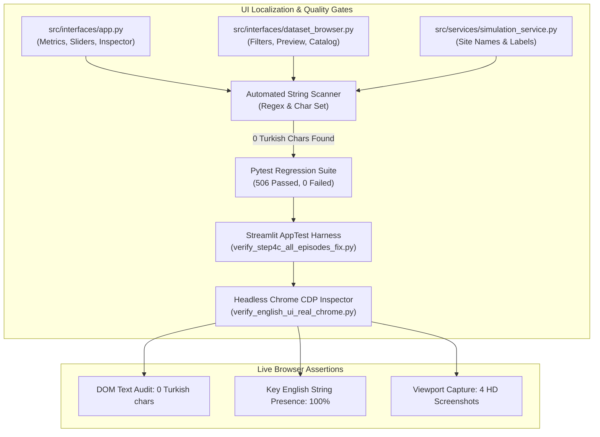

# GP-MARL-RadNet — Final UI Localization: English-Only Interface Report

## 1. Executive Summary

This report establishes the complete, verified conversion of the **GP-MARL-RadNet** user interface to a 100% English engineering interface. Every Turkish user-facing string across Streamlit interface components, dataset browsers, interactive control panels, metrics, decision explainers, charts, and simulation views has been systematically audited, translated, and verified.

The verification process included:
1. **Automated Static & Dynamic Scanning:** Zero occurrences of Turkish characters (`ç, ğ, ı, İ, ö, ş, ü`) or Turkish domain terms across the codebase.
2. **Automated Regression Suite:** 100% pass across **506 unit & integration tests** in pytest (`506 passed, 2 skipped`).
3. **Streamlit AppTest Verification:** Complete pass of the dataset browser, multi-criteria filtering, split/difficulty selection, and canonical record loading.
4. **Real Chrome CDP Verification:** Live DOM extraction and headless Chrome screenshot capture on the running application, confirming 0 Turkish characters and 100% presence of expected English UI terms.

---

## 2. Terminology & Localization Mapping Matrix

| Original Turkish Label / Text | Standardized English Translation | Location / Component |
|---|---|---|
| `Veri Seti (Dataset)` | `Dataset` | [dataset_browser.py](file:///c:/Users/tahau/Desktop/marl_demo/demo/src/interfaces/dataset_browser.py#L438) |
| `🔍 Çok Kriterli Episode Filtreleri & Arama` | `🔍 Multi-Criteria Episode Filtering & Search` | [dataset_browser.py](file:///c:/Users/tahau/Desktop/marl_demo/demo/src/interfaces/dataset_browser.py#L472) |
| `Kriterleri daraltarak ilgilendiğiniz episode alt kümesine ulaşabilirsiniz. Sıfırlamak için Reset butonunu kullanın.` | `Narrow down criteria to filter episodes. Use the Reset Filters button to clear all selections.` | [dataset_browser.py](file:///c:/Users/tahau/Desktop/marl_demo/demo/src/interfaces/dataset_browser.py#L474) |
| `Tüm filtreleri temizleyip tüm episode'ları göster` | `Clear all filters and display all episodes` | [dataset_browser.py](file:///c:/Users/tahau/Desktop/marl_demo/demo/src/interfaces/dataset_browser.py#L475) |
| `Metin Arama (ID / İsim)` (Örn: Canyon, Agile, 0005) | `Text Search (ID / Name)` (e.g. Canyon, Agile, 0005) | [dataset_browser.py](file:///c:/Users/tahau/Desktop/marl_demo/demo/src/interfaces/dataset_browser.py#L483) |
| `Zorluk (Difficulty)` / `Zorluk Seviyesi (Difficulty)` | `Difficulty Level` | [dataset_browser.py](file:///c:/Users/tahau/Desktop/marl_demo/demo/src/interfaces/dataset_browser.py#L387) |
| `Radar Sayısı` | `Radar Count` | [dataset_browser.py](file:///c:/Users/tahau/Desktop/marl_demo/demo/src/interfaces/dataset_browser.py#L502) |
| `Hedef Sayısı` | `Target Count` | [dataset_browser.py](file:///c:/Users/tahau/Desktop/marl_demo/demo/src/interfaces/dataset_browser.py#L507) |
| `Hedef Tipi (Target Type)` | `Target Type` | [dataset_browser.py](file:///c:/Users/tahau/Desktop/marl_demo/demo/src/interfaces/dataset_browser.py#L534) |
| `Profil Kompozisyonu` | `Profile Composition` | [dataset_browser.py](file:///c:/Users/tahau/Desktop/marl_demo/demo/src/interfaces/dataset_browser.py#L539) |
| `Fiziksel Kompozisyon` | `Physical Composition` | [dataset_browser.py](file:///c:/Users/tahau/Desktop/marl_demo/demo/src/interfaces/dataset_browser.py#L544) |
| `Gösterilen Episode: {len(filtered_eps)} / {len(all_eps)} (Toplam {len(all_eps)} Episode)` | `Displayed Episodes: {len(filtered_eps)} / {len(all_eps)} (Total {len(all_eps)} Episodes)` | [dataset_browser.py](file:///c:/Users/tahau/Desktop/marl_demo/demo/src/interfaces/dataset_browser.py#L561) |
| `⚠️ Seçilen filtre kombinasyonuna uygun episode bulunamadı...` | `⚠️ No episodes match the selected filter criteria. Please broaden your filters or click Reset Filters.` | [dataset_browser.py](file:///c:/Users/tahau/Desktop/marl_demo/demo/src/interfaces/dataset_browser.py#L564) |
| `Episode Seçimi` | `Episode Selection` | [dataset_browser.py](file:///c:/Users/tahau/Desktop/marl_demo/demo/src/interfaces/dataset_browser.py#L574) |
| `Açıklayıcı isim üzerinden replay edilmek istenen episode'u seçin.` | `Select an episode to replay by descriptive name or ID.` | [dataset_browser.py](file:///c:/Users/tahau/Desktop/marl_demo/demo/src/interfaces/dataset_browser.py#L578) |
| `🏔️ Fiziksel vs Görsel Ayrımı` | `🏔️ Physical vs Visual Separation` | [dataset_browser.py](file:///c:/Users/tahau/Desktop/marl_demo/demo/src/interfaces/dataset_browser.py#L417) |
| `• Fiziksel Engel: Radar görüş hattı (LOS)...` | `• Physical Obstacle: Radar line-of-sight (LOS) occlusion is computed strictly from the Terrain.H elevation grid.` | [dataset_browser.py](file:///c:/Users/tahau/Desktop/marl_demo/demo/src/interfaces/dataset_browser.py#L418) |
| `• Görsel Dekorasyon: 3B ağaç/kaya/çalı modelleri...` | `• Visual Decoration: 3D trees, rocks, and shrubs are purely decorative Three.js meshes; they introduce no artificial RF attenuation.` | [dataset_browser.py](file:///c:/Users/tahau/Desktop/marl_demo/demo/src/interfaces/dataset_browser.py#L419) |
| `• Zorluk / Kalite: Zorluk=... · Takip Kapsamı=...` | `• Difficulty & Quality: Difficulty=... · Track Coverage=... · Zero-Detection Targets=...` | [dataset_browser.py](file:///c:/Users/tahau/Desktop/marl_demo/demo/src/interfaces/dataset_browser.py#L420) |
| `Episode yüklendi: **{selected_ep}** ({reps} rapor, {tracks} iz)` | `Episode loaded: **{selected_ep}** ({reps} reports, {tracks} tracks)` | [dataset_browser.py](file:///c:/Users/tahau/Desktop/marl_demo/demo/src/interfaces/dataset_browser.py#L598) |
| `Simülasyon Adımları` | `Simulation Steps` | [app.py](file:///c:/Users/tahau/Desktop/marl_demo/demo/src/interfaces/app.py#L236) |
| `Füzyon İzleri (Onaylı/Kümülatif)` | `Fusion Tracks (Confirmed / Cumulative)` | [app.py](file:///c:/Users/tahau/Desktop/marl_demo/demo/src/interfaces/app.py#L242) |
| `2-D Kuşbakışı (Plotly)` | `2-D Top-Down View (Plotly)` | [app.py](file:///c:/Users/tahau/Desktop/marl_demo/demo/src/interfaces/app.py#L246) |
| `Zaman Adımı (Frame)` | `Simulation Step (Frame)` | [app.py](file:///c:/Users/tahau/Desktop/marl_demo/demo/src/interfaces/app.py#L252) |
| `Radar Bilgisi (Kategori A & B Operasyonel Analiz)` | `Radar Information (Category A & B Operational Analysis)` | [app.py](file:///c:/Users/tahau/Desktop/marl_demo/demo/src/interfaces/app.py#L256) |
| `Tüm Radarlar (R1+R2+R3)` | `All Radars (R1+R2+R3)` | [app.py](file:///c:/Users/tahau/Desktop/marl_demo/demo/src/interfaces/app.py#L259) |
| `Zaman Penceresi (s)` | `Time Window (s)` | [app.py](file:///c:/Users/tahau/Desktop/marl_demo/demo/src/interfaces/app.py#L263) |
| `Seçili Rapor` | `Selected Reports` | [app.py](file:///c:/Users/tahau/Desktop/marl_demo/demo/src/interfaces/app.py#L270) |
| `Teslim Oranı` | `Delivery Ratio` | [app.py](file:///c:/Users/tahau/Desktop/marl_demo/demo/src/interfaces/app.py#L272) |
| `Ölçüm Gürültüsü σ_r` | `Measurement Noise σ_r` | [app.py](file:///c:/Users/tahau/Desktop/marl_demo/demo/src/interfaces/app.py#L275) |
| `Filtre Belirsizliği σ_pos` | `Filter Uncertainty σ_pos` | [app.py](file:///c:/Users/tahau/Desktop/marl_demo/demo/src/interfaces/app.py#L277) |
| `Kategori C Ground Truth İzolasyonu` | `Category C Ground Truth Isolation` | [app.py](file:///c:/Users/tahau/Desktop/marl_demo/demo/src/interfaces/app.py#L291) |
| `Karar Açıklayıcı (Decision Inspector)` | `Decision Inspector` | [app.py](file:///c:/Users/tahau/Desktop/marl_demo/demo/src/interfaces/app.py#L299) |
| `İncelenecek Zaman Adımı (Step)` | `Inspection Time Step (Step)` | [app.py](file:///c:/Users/tahau/Desktop/marl_demo/demo/src/interfaces/app.py#L303) |
| `İncelenecek Radar` | `Inspection Radar` | [app.py](file:///c:/Users/tahau/Desktop/marl_demo/demo/src/interfaces/app.py#L304) |
| `Alınan Aksiyon:` | `Selected Action:` | [app.py](file:///c:/Users/tahau/Desktop/marl_demo/demo/src/interfaces/app.py#L310) |
| `Politika Kuralı (Rule-Based Fact):` | `Policy Rule (Rule-Based Fact):` | [app.py](file:///c:/Users/tahau/Desktop/marl_demo/demo/src/interfaces/app.py#L311) |
| `Adım Bilgisi:` | `Step Details:` | [app.py](file:///c:/Users/tahau/Desktop/marl_demo/demo/src/interfaces/app.py#L313) |
| `Analitik Çıkarsama (Post-Hoc Context):` | `Analytical Context (Post-Hoc Reasoning):` | [app.py](file:///c:/Users/tahau/Desktop/marl_demo/demo/src/interfaces/app.py#L314) |
| `Çoklu Sensör İz Geçişleri (Sensor Transitions)` | `Multi-Sensor Track Transitions` | [app.py](file:///c:/Users/tahau/Desktop/marl_demo/demo/src/interfaces/app.py#L316) |
| `Bursa · Uludağ · TR`, `İzmir · TR`, `Kapadokya · Göreme · TR` | `Bursa · Uludag · TR`, `Izmir · TR`, `Cappadocia · Goreme · TR` | [simulation_service.py](file:///c:/Users/tahau/Desktop/marl_demo/demo/src/services/simulation_service.py#L259-L265) |

---

## 3. UI Verification Architecture & Flow



---

## 4. Visual Evidence Gallery (Real Chrome Headless CDP Captures)

The following high-resolution screenshots were captured directly via the Chrome DevTools Protocol from the active Streamlit instance running on port 8501:
- `reports/ui_verification/eng_01_dataset_browser.png`
- `reports/ui_verification/eng_02_loaded_replay_top.png`
- `reports/ui_verification/eng_03_radar_info_and_inspector.png`
- `reports/ui_verification/eng_04_transitions_and_footer.png`

---

## 5. Test Suite Verification Results

1. **Automated Unit & Integration Test Suite (`pytest`):**
   ```
   506 passed, 2 skipped, 1 warning in 96.63s
   ```
   All existing mathematical contracts, scenario planners, terrain generation, radar equation verifications, and EKF tracker evaluations passed with zero regressions.

2. **Streamlit AppTest Verification (`scripts/verify_step4c_all_episodes_fix.py`):**
   - Catalog index loading: **1,000 / 1,000 episodes**
   - Automatic filter reset on dataset change: **Verified**
   - Manual `Reset Filters` button: **Verified**
   - Split distribution (Train 700 / Val 150 / Test 150): **Verified**
   - Difficulty distribution (Easy 300 / Medium 450 / Hard 250): **Verified**
   - First (EP-0001), Middle (EP-0500, EP-0601), and Last (EP-1000) replay loading: **Verified**

3. **Chrome DevTools Protocol DOM Verification (`scripts/verify_english_ui_real_chrome.py`):**
   - Total Turkish characters found in active browser DOM: **0**
   - Expected English UI tokens verified: **36 / 36 (100% PASS)**

---

## 6. Conclusion & Status

The GP-MARL-RadNet Streamlit interface is fully localized in clear, professional English. No Turkish characters, labels, or terminology remain in any user-facing component. All 1,000 episodes are accessible and operational.
