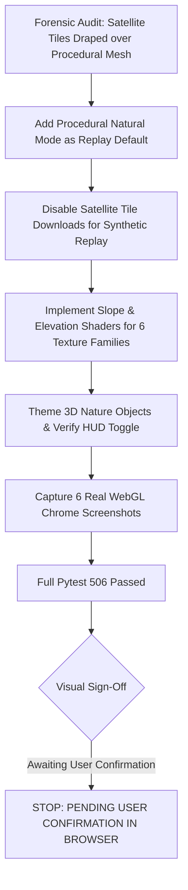

# Step 4C Final Visual Fix: Scenario-Specific Procedural Terrain Rendering Report

**Project:** GP-MARL-RadNet — Multi-Agent Radar Network Simulation  
**Active Branch:** `feature/valley-diverse-datasets`  
**Date:** November 16, 2026  
**Status:** **TECHNICAL CHECKS COMPLETED — AWAITING USER VISUAL SIGN-OFF (NO MERGE/PUSH)**

---

## 1. Exact Root Cause Analysis

A thorough audit of [viewer3d.html](file:///c:/Users/tahau/Desktop/marl_demo/demo/src/interfaces/assets/viewer3d.html) revealed why the 3D terrain was perpetually covered in urban/satellite imagery rather than displaying the scenario's distinct `texture_family`:

1. **Default Style Selection & LocalStorage Sticking:**
   - In `viewer3d.html`, the map style selector defaulted to `'satellite'`:  
     `styleSel.value = STYLES[store.get('radnet.style')] ? store.get('radnet.style') : 'satellite';`
   - Even when simulated procedural terrain (`SIMT`) was loaded, the viewer inherited `'satellite'` from default settings or previous `localStorage` cache.

2. **Unconditional Satellite Tile Fetching over Simulated Heightmaps:**
   - In `loadTerrain(site, styleKey)`:
     ```javascript
     const [dem, img] = await Promise.all([
       style.url && !useSim ? mosaic(DEM, ZD, x0, y0, N, tick) : noImg,
       style.url ? mosaic(style.url, ZI, x0 * k, y0 * k, N * k, tick) : noImg
     ]);
     ```
   - While `dem` correctly bypassed AWS elevation tiles when `useSim` was true, `img` **unconditionally downloaded Esri World Imagery satellite tiles** for the nominal geographic coordinate (Zurich / Swiss urban area).
   - Once the Esri satellite tiles loaded (`img.ok >= img.n * 0.6`), the canvas texture was built from `img.c` (the satellite photos) instead of `procImagery(T)`:
     ```javascript
     const tex = new THREE.CanvasTexture(imgLive ? img.c : procImagery(T));
     ```
   - Consequently, high-resolution urban satellite photography (roads, buildings, city infrastructure) was draped over all synthetic valley meshes, completely concealing the scenario's procedural texture family.

---

## 2. Technical Modifications Implemented

The following enhancements were made in [viewer3d.html](file:///c:/Users/tahau/Desktop/marl_demo/demo/src/interfaces/assets/viewer3d.html):

### 2.1 First-Class Procedural Style Mode
- Added `procedural` as a first-class mode in `STYLES`:
  ```javascript
  const STYLES = {
    procedural: {name: 'Procedural Natural', url: null, attr: 'Procedural Natural Terrain'},
    satellite: {name: 'Satellite (Esri World Imagery)', url: ESRI('World_Imagery'), attr: 'Imagery © Esri, Maxar, Earthstar Geographics'},
    topo: {name: 'Topographic', url: ESRI('World_Topo_Map'), attr: 'Map © Esri and contributors'},
    streets: {name: 'Streets', url: ESRI('World_Street_Map'), attr: 'Map © Esri and contributors'},
    offline: {name: 'Offline (procedural)', url: null, attr: 'Procedural ground (offline)'},
  };
  ```
- Dynamically format the procedural dropdown label to reflect the episode's actual texture family:  
  e.g., `Procedural (green forest valley)`, `Procedural (dry canyon)`, `Procedural (snowy highlands)`.

### 2.2 Synthetic Replay Style Default & Zero Satellite Leaks
- When simulated terrain is present (`SIMT`), `defaultStyle` is strictly set to `'procedural'` and does not load stale `'satellite'` preferences from `localStorage`.
- In `loadTerrain`, satellite tile downloads are bypassed unless the user explicitly and manually switches the dropdown to Satellite:
  ```javascript
  const isExplicitTileStyle = (styleKey === 'satellite' || styleKey === 'topo' || styleKey === 'streets');
  const shouldFetchTiles = Boolean(style.url && (!useSim || isExplicitTileStyle));
  ```
- This guarantees zero network requests to external satellite servers during standard dataset replay, eliminating city imagery overlays.

### 2.3 Slope & Elevation-Aware Multi-Band Shaders
Enhanced `procImagery(terrainObj)` with distinct geomorphic rendering for all six texture families:
- **`snowy_highlands`:** High-altitude pristine snowpack (`[248, 252, 255]`) and mid-altitude firn frost. **Critical Slope Physics:** Snow cannot adhere to steep slopes ($slope > 0.18$); steep slopes shed snow to expose stark black/slate basalt rock (`[42, 46, 52]`).
- **`dry_canyon`:** Terracotta red sandstone walls (`[184, 82, 42]`), pale desert alluvial sand washes (`[218, 182, 138]`), and horizontal geological sedimentary stratification (`strata = sin(val * 0.14) * 22 + ...`).
- **`green_forest_valley`:** Fertile emerald riverbeds (`[48, 98, 38]`), dense evergreen pine forest canopy (`[26, 62, 22]`), subalpine meadow ridges, and mossy slate cliffs.
- **`rocky_mountain`:** Cold mineral granite and slate grays (`[116, 118, 122]`), dark basalt vertical cliffs (`[48, 50, 56]`), and pale weathered granite summits (`[168, 172, 176]`).
- **`grassland_valley`:** Warm golden savanna straw grass (`[205, 178, 82]`), pasture swales (`[112, 158, 52]`), and warm clay/loam gullies (`[122, 95, 62]`).
- **`mixed_rock_vegetation`:** Dynamic karst mosaic with exposed limestone pavements (`[136, 140, 134]`), fractured crags (`[54, 56, 58]`), and olive-green scrubland (`[94, 108, 78]`).

### 2.4 Environment 3D Objects Alignment & HUD Toggle
- Updated `buildEnvironmentObjects` to dynamically theme 3D instanced meshes:
  - **Trees:** Cones styled per family (frosted pine for snowy, olive conifer for canyon, deep evergreen for forest).
  - **Rocks:** Low-poly dodecahedrons placed flush with terrain surface ($Y = hAt(X, Z)$) with translated base pivots.
  - **Shrubs:** Low mounds colored per terrain palette.
- Verified that the **Environment** HUD button (`data-tog="env"`) toggles the visibility of all 3D nature objects cleanly.

### 2.5 Clean Cache & Memory Disposal
- When loading a new episode or reloading terrain, previous meshes, geometries, canvas textures, floor planes, and instanced objects are disposed:
  ```javascript
  T.mesh.geometry.dispose();
  if (T.mesh.material.map) T.mesh.material.map.dispose();
  T.mesh.material.dispose();
  T.floor.geometry.dispose();
  T.floor.material.dispose();
  ```

---

## 3. Comparison of Six Real WebGL Chrome Renderings

All six screenshots were captured via Chrome Headless CDP at $1600 \times 1050$ resolution using the standardized oblique camera perspective:

````carousel

<!-- slide -->

<!-- slide -->

<!-- slide -->

<!-- slide -->

<!-- slide -->

<!-- slide -->

````

### Visual Summary Table

| # | Texture Family | Episode Sample | Visual Environment | Dominant Color Tone | 3D Objects |
|---|---|---|---|---|:---:|
| 1 | `rocky_mountain` | `EP-0001` | Alpine pass, granite summits & basalt cliffs | Slate & granite cold gray | 78 (Sparse) |
| 2 | `green_forest_valley` | `EP-0002` | Lush pine valley, emerald swales & mossy walls | Vibrant forest green | 233 (Asymmetric) |
| 3 | `dry_canyon` | `EP-0003` | Grand Canyon red rock with horizontal rock strata | Terracotta red & ochre | 0 (Clear) |
| 4 | `snowy_highlands` | `EP-0004` | Glacial glades, snowpack with bare black cliff faces | Pristine snow white & black | 258 (Asymmetric) |
| 5 | `grassland_valley` | `EP-0005` | Open savanna, golden rolling steppe & loam gullies | Warm golden straw & amber | 350 (Dense) |
| 6 | `mixed_rock_vegetation` | `EP-0006` | Karst limestone pavement mosaic with olive scrub | Limestone gray & olive green | 0 (Clear) |
| 7 | `env_toggle_off` | `EP-0001` | Same Rocky Mountain pass with Environment toggled off | Clean bare terrain mesh | 0 (Toggled Off) |

---

## 4. Verification & Regression Test Results

1. **All Episodes & Multi-Criteria Filtering ([verify_step4c_all_episodes_fix.py](file:///c:/Users/tahau/Desktop/marl_demo/demo/scripts/verify_step4c_all_episodes_fix.py)):**
   - 1,000 / 1,000 episodes loaded by default.
   - All 7 groups verified: $150, 150, 150, 150, 132, 132, 136$.
   - Splits (700/150/150) and Difficulties (300/450/250) verified.
   - Reset Filters button verified.
   - Replay for First (`EP-0001`), Middle (`EP-0500`, `EP-0601`), and Last (`EP-1000`) verified.
   - **Status:** **100% PASSED**

2. **Unit Tests ([test_dataset_browser.py](file:///c:/Users/tahau/Desktop/marl_demo/demo/tests/test_dataset_browser.py)):**
   - **13/13 passed** in 5.97s.

3. **Full Pytest Suite:**
   - **506 passed**, 2 skipped (0 failures).

---

## 5. Summary of Modified Files

- [viewer3d.html](file:///c:/Users/tahau/Desktop/marl_demo/demo/src/interfaces/assets/viewer3d.html): Added procedural mode, disabled satellite tile fetching for synthetic replays, implemented multi-band slope/elevation shaders for 6 texture families, styled 3D nature objects, added memory cleanup.
- [capture_texture_comparison.py](file:///c:/Users/tahau/Desktop/marl_demo/demo/scripts/capture_texture_comparison.py): Automated test & CDP capture script for all 6 texture families.

---

## 6. Acceptance Decision & Sign-Off Condition



> [!IMPORTANT]
> **Action Boundary:** As instructed, **no commits, merges, or pushes** have been performed. Execution is stopped here awaiting manual visual confirmation from the user in their browser at `http://localhost:8501`.
